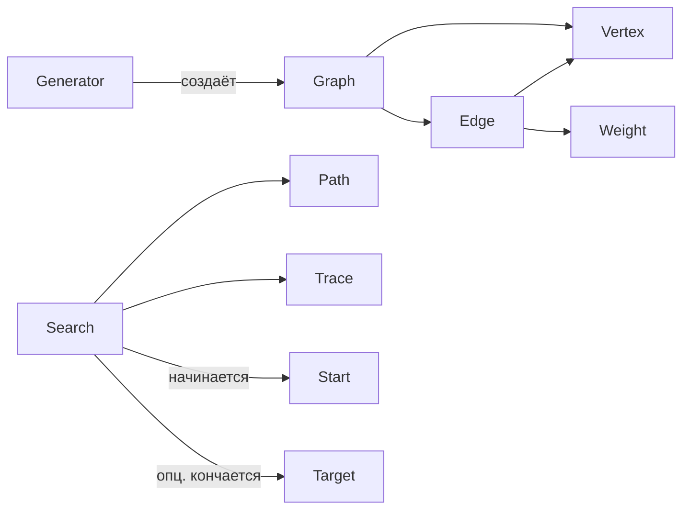

---

## Результаты бенчмарка 

```markdown
| n    | Рёбра | Dijkstra, ms |
|-----:|------:|-------------:|
| 100  | 398   | 1.304        |
| 200  | 798   | 8.600        |
| 500  | 1988  | 102.608      |
| 1000 | 3994  | 791.772      |
| 1500 | 5996  | 2687.490     |
| 2000 | 7992  | 6254.250     |
| 2500 | 9992  | 12326.900    |

# ЛР-3: Графовые алгоритмы — Дейкстра + генерация графов

## 1. Постановка задачи

**Что:** инструмент поиска кратчайших путей на графе (Дейкстра) с генерацией графов заданной топологии, консольным и Qt-интерфейсом, тестами и бенчмарком.

**Зачем:** учебная демонстрация и заготовка для задач маршрутизации — навигация, сети, логистика, планирование.

**Выбранные пункты:** M-2.2.1 Дейкстра (5) + M-3.1 Генерация графов (10) = **15 ≥ 12**.

## 2. Сущности

| Сущность | Описание |
|---|---|
| Вершина | Пункт маршрутизации с ключом и данными |
| Ребро | Направленная связь с весом |
| Граф | Множество вершин и рёбер |
| Старт / Цель | Начало и опциональный конец поиска |
| Путь / Расстояние | Последовательность рёбер / сумма весов |
| Трасса | Последовательность шагов алгоритма для визуализации |
| Топология | Правило генерации (random / tree / complete / DAG) |



## 3. Архитектура

```
┌──────────┐   ┌──────────┐
│   CLI    │   │   GUI    │   ← UI-слой (без логики поиска)
└────┬─────┘   └────┬─────┘
     └──────┬───────┘
            ▼
   ┌─────────────────┐
   │  Прикладная     │
   │  логика:        │
   │  Graph,         │
   │  Dijkstra,      │
   │  Trace,         │
   │  Generators,    │
   │  Benchmark      │
   └────────┬────────┘
            ▼
   ┌─────────────────┐
   │  Структуры ЛР-1 │
   │  / ЛР-2 + utils │
   └─────────────────┘
```

**Ключевые решения:**

- **Ассоциативное хранение** (ключ → значение) для вершин и рёбер — O(1) в среднем на проверку/получение веса, память O(V+E). Лучше матрицы (O(V²) памяти) и списков смежности (O(deg) на проверку).
- **Неориентированное ребро = два направленных** — упрощает алгоритм; цена — `get_count_edges()` удваивается для неориентированных.
- **Обобщённость по типам** — граф параметризован ключом, данными, весом.
- **Дейкстра** — линейный поиск минимума (без кучи); осознанное ограничение, даёт Θ(V³) на практике (бенчмарк подтверждает). Замена на кучу → O((V+E) log V) — это M-3.4.
- **Досрочный выход** при достижении цели — корректно по теореме Дейкстры.
- **Отдельный компонент трассировки** — `Search` не зависит от UI, но GUI получает полную последовательность шагов.
- **Генераторы** — 4 стратегии, детерминированный seed для воспроизводимости.
- **UI не содержит логики** — CLI и GUI вызывают одни функции; тесты не зависят от UI.

## 4. Функциональные требования

**Граф:** добавить/удалить вершину и ребро, изменить вес, запросить данные, очистить. Идемпотентность добавления.

**Поиск (Дейкстра):** от стартовой вершины → расстояния + `previous`; недостижимые = ∞; досрочный стоп при цели; `vertex_not_found` при отсутствии старта. Только неотрицательные веса.

**Трассировка:** шаги Select / Relax / Reject / Done с текущей вершиной, соседом, старым и новым расстоянием. Согласована с «чистым» поиском.

**Генераторы:** случайный / дерево / полный / DAG — с параметрами n, m, wmax, seed. Инварианты: дерево связно, полный — все пары, DAG без циклов. Детерминизм по seed.

**Бенчмарк:** прогон на n = 100…2500, замер вокруг поиска, экспорт в CSV `n, edges, time_ms`.

**CLI:** меню Demo / Random / Tree / Complete / DAG / Show / Dijkstra / Benchmark / Exit. Не падать при некорректном вводе.

**GUI:** холст с графом, Start/Target, Run/Step/Play/Pause/Reset, слайдер скорости, режим редактирования (добавить/удалить вершину и ребро, задать вес). Цветовая модель: белый=unvisited, голубой=frontier, жёлтый=current, зелёный=visited, красный=unreachable; ребро зелёное — успешная релаксация, красное — отказ. После редактирования трасса инвалидируется.

**Тесты:** пустой граф, одиночная вершина, известный ответ, недостижимые, отсутствующий старт, 4 генератора, детерминизм. UI не тестируется.

## 5. Сборка и запуск

```bash
cmake -S . -B build
cmake --build build -j

./build/lab3          # консольное меню
./build/lab3_gui      # Qt GUI (если найден Qt)
./build/lab3_tests    # 19 тестов Google Test
```

Зависимости:
- C++17
- Google Test (скачивается через `FetchContent`)
- Qt 5/6 Widgets (опционально — GUI отключается, если не найден)

## 6. Бенчмарк

Замеры Дейкстры на `gen_random(n, 4n)`, seed = 7, стартовая вершина 0. Время в мс.

| n    | Рёбра | Dijkstra, ms | T(n)/n³   |
|-----:|------:|-------------:|----------:|
| 100  | 398   | 1.304        | 1.30·10⁻⁶ |
| 200  | 798   | 8.600        | 1.08·10⁻⁶ |
| 500  | 1988  | 102.608      | 8.21·10⁻⁷ |
| 1000 | 3994  | 791.772      | 7.92·10⁻⁷ |
| 1500 | 5996  | 2687.490     | 7.96·10⁻⁷ |
| 2000 | 7992  | 6254.250     | 7.82·10⁻⁷ |
| 2500 | 9992  | 12326.900    | 7.89·10⁻⁷ |

Отношение `T(n)/n³` стабильно ≈ 8·10⁻⁷ → эмпирическая сложность **Θ(n³)**, а не Θ(n²).

**Почему Θ(n³), а не O(V²+E):** теоретическая оценка Дейкстры с линейным поиском минимума — O(V²+E). В данной реализации внутри `find_min` для каждой из V непоссещённых вершин вызывается `find_position`, который сам O(V). Итого V·V·V = V³.

**Путь улучшения:** заменить линейный поиск на приоритетную очередь (M-3.4) → O((V+E) log V), ускорение на n=2500 в ~200 раз.

## 7. Структура проекта

```
lab3/
├── CMakeLists.txt
├── main.cpp                    консольное меню
├── libs/
│   ├── Option.hpp              опциональное значение
│   ├── Pair.hpp                ключ рёбер
│   └── Exceptions.hpp          исключения
├── structs/
│   ├── DynamicArray.hpp        базовый T* с size
│   ├── Sequence.hpp            абстрактный интерфейс
│   ├── MutableArraySequence.hpp
│   ├── LinkedList.hpp          цепочки в хеш-таблице
│   ├── IDictionary.hpp
│   └── HashTableDictionary.hpp
├── graph/
│   ├── graph_exceptions.hpp
│   ├── Graph.hpp               граф + Дейкстра
│   ├── GraphGenerator.hpp      4 генератора (M-3.1)
│   └── DijkstraSteps.hpp       трассировка для GUI
├── gui/
│   ├── main.cpp
│   ├── Gui.hpp
│   └── Gui.cpp                 Qt-визуализация
└── tests/
    └── test_graph.cpp          19 тестов
```

## 8. Соответствие требованиям ЛР

| Требование | Выполнение |
|---|---|
| ≥ 1 графовый алгоритм | Дейкстра (M-2.2.1) |
| Общность структур | шаблон `Graph<Index, VertexData, Weight, Container>` |
| Структуры из прошлых ЛР | `MutableArraySequence`, `HashTableDictionary` на `LinkedList` |
| Тесты на алгоритмы | 19 тестов Google Test |
| Ручная + авто-проверка | Demo-граф с известным ответом + тесты |
| UI | консоль + Qt GUI |
| Измерение времени | `std::chrono` вокруг `dijkstra()` |
| Сравнение/CSV | `Benchmark->CSV` → `results.csv` |
| Просмотр исходных данных | `Show graph`, GUI |

## 9. Итог

| Параметр | Значение |
|---|---|
| Алгоритм | Дейкстра (M-2.2.1) |
| Генерация | 4 топологии (M-3.1) |
| Рейтинг | **15 / 12** ✓ |
| Сложность (факт) | Θ(V³), подтверждено бенчмарком |
| Сложность (теория) | O(V² + E) |
| Путь улучшения | PriorityQueue → O((V+E) log V) — M-3.4 |
